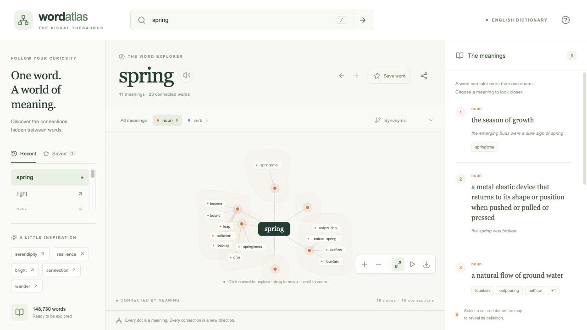

# Word Atlas — a server-hosted visual thesaurus

[](https://github.com/juangrukat/word-atlas/actions/workflows/ci.yml)

A working browser recreation of the classic visual thesaurus: search a word, inspect its separate meanings, explore synonym clusters, and expand related meanings. The app uses a newly written TypeScript/Fastify server, React/D3 browser interface, and a read-only SQLite dictionary. Java, Lucene, Windows and the original application are **not required at runtime**.



This is a standalone application repository: it includes the full runtime dictionary, source code, locked dependencies and Docker configuration. A fresh clone needs no access to the original installer or the reverse-engineering workspace. The included recovered lexical data retains its original provenance and notices; runtime independence does not change those notices.

## Start with Docker

Clone the repository using an account with access, then start the app:

```sh
git clone https://github.com/juangrukat/word-atlas.git
cd word-atlas
docker compose up --build -d
```

Open `http://YOUR_SERVER:3000`. The Compose file publishes port 3000. For an existing reverse proxy, change its port mapping to `127.0.0.1:3000:3000`, then proxy your domain to that address. The application has no account/login system; use your existing proxy access controls if you need them.

```sh
docker compose logs -f
docker compose down
```

The container runs as a non-root user with a read-only filesystem and a health check. It contains its own read-only lexical database and needs no separate database service. Saved words and recent searches are stored in each browser, not in the container. The 512 MB Compose memory limit can be adjusted for your deployment.

## Start directly with Node

Use Node **22.13 or later in the 22.x line**. The package uses Node 22's built-in SQLite API; this version currently prints an experimental API warning. No native npm compilation is needed.

```sh
npm ci
npm run build
npm start
```

Open `http://127.0.0.1:3000`. Direct Node execution binds to loopback by default. To listen on your server network:

```sh
HOST=0.0.0.0 PORT=3000 npm start
```

The release archive includes `dist/` and `build/`, so you can also use `npm ci --omit=dev` followed by `npm start` without rebuilding. Build again after source changes.

## Develop and verify

Run `npm run dev` for the API on port 3000. In another terminal run `npm run dev:ui` for Vite on port 5173; Vite proxies `/api` to the API. To test production behavior, use `npm run build` and `npm start`.

```sh
npm run build
npm test
npm run stress
```

## Included behavior

- Complete recovered English dictionary: **148,730 words**, **117,659 meanings and definitions**, **206,978 word/meaning memberships**, and **377,488 semantic/lexical relationships**.
- Meaning clusters with independent word and meaning identities, shell placement, springs, repulsion, label protection, and part-of-speech colors.
- Exact lookup, autocomplete, spelling suggestions and stored irregular-form lookup.
- Synonyms, opposite meanings, broader/narrower meanings and other relationship views. Directed semantic connections have arrowheads; dashed edges distinguish related meanings from direct word memberships.
- Select a meaning to read its definition and examples, then expand its neighborhood without losing the current zoom.
- Click a word to recenter; drag nodes, pan the background, scroll to zoom, fit the map, or pause motion.
- Previous/next word navigation, browser history, shareable word URLs, browser-local saved words and recent searches.
- SVG map download, responsive mobile layout, keyboard controls and reduced-motion support.
- Optional pronunciation through the browser's available speech synthesis. Original audio recordings are not included.

The initial map shows up to eight meanings; “More meanings” increases this to 32. All definitions remain in the definition panel. Each API graph is capped at 180 nodes; incremental client expansion is capped at 220 nodes and 500 edges. A focused map is intentional so highly connected words remain navigable. “Fit map” shows the full current graph; zooming restores label detail.

## API

| Request | Result |
| --- | --- |
| `GET /api/health` | Process/dictionary health |
| `GET /api/stats` | Corpus counts |
| `GET /api/suggest?q=serend&limit=8` | Prefix or similar-spelling words |
| `GET /api/lookup?word=bank` | Definitions and graph |
| `GET /api/lookup?word=bank&pos=noun&relations=broader&senses=12` | Filtered graph; definitions remain complete |
| `GET /api/meanings/123/expand?relations=all` | One meaning and its bounded neighborhood |

Relationship modes: `synonyms`, `broader`, `narrower`, `antonyms`, `similar`, `all`. Parts of speech: `noun`, `verb`, `adjective`, `adverb`; comma-separated combinations are supported by the API. An absent word/meaning returns 404; malformed inputs return 400. HTTP requests are rate-limited to 120 per minute per source IP; health checks are exempt. The server deliberately does not trust proxy headers by default.

Environment variables: `HOST`, `PORT`, and `DICTIONARY_PATH` (default `data/dictionary.sqlite`).

## Data recovery and provenance

The included dictionary was recovered from the user-supplied 2009 Visual Thesaurus 3.0.3 installer using its bundled read-only Lucene reader. No installer or desktop UI was launched. Exported field arrays and base-36 numeric encodings were checked; import passed SQLite integrity and foreign-key checks. Provenance, source/record hashes and counts are in `data/provenance.json`.

To repeat extraction, compile `scripts/ExportDictionary.java` against the original extracted `vt3c.jar`, export `idict/en` and `idict/synset` to `en-records.jsonl` and `synset-records.jsonl`, then import them:

```sh
python3 scripts/import_dictionary.py --source /absolute/path/to/exported-records
```

The original software license is preserved in `data/ORIGINAL-SOFTWARE-LICENSE.txt`. See `THIRD_PARTY_NOTICES.md`. The new implementation does not establish different rights for the recovered data.

## Practical limits

This recreation preserves the original visual exploration concept and recovered relationships; it does not claim pixel-for-pixel or numerical equivalence to the desktop engine. Original SDK code, registration flows, remote services, screensaver and proprietary audio playback are not part of the new runtime. The corpus is the recovered 2009 English dataset, not a continually updated dictionary. No server-side user accounts or synchronized word lists are implemented.

The production app and browser interactions were verified directly with Node on this Mac. GitHub CI also passed on Linux: all 19 tests, production build, Docker image build and startup, health checks, ambiguous-word lookups and client asset delivery. [Verified CI run](https://github.com/juangrukat/word-atlas/actions/runs/38148618925). Deployment to your own server has not been performed. See `docs/verification.md` for the completed checks.

Version 1.0.1 includes the ambiguous-word stress-test fixes for route rate limiting and crowded-label separation. See `docs/stress-test.md` for the 24-word test, local load measurements and browser results.
